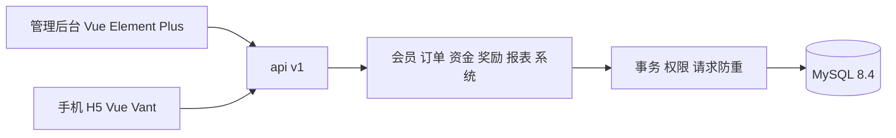

# 初语山言开发交接

交接日期：2026-10-30，上海时区。功能验收基线为 `b057b8072af4f2f2b53dbe943026167d72834ee0`。交接文档之后的提交号，以 Git 当前版本和交接包的版本清单为准。

当前已完成全新后端、管理后台、手机 H5，以及对需求表和 V2 方案的一轮全面复核。交付使用独立演示数据；下一步是收口正式规则、在目标环境验证部署，并按确定的范围接入正式通道。

## 先做这五步

1. 核对仓库、提交号与本地改动：`git remote -v`、`git log -1`、`git status --short`。保留已有改动，不覆盖当前数据库。
2. 阅读本文件，再看 [业务决策](DECISIONS.md)、[逐项需求复核](REQUIREMENTS-AUDIT.md) 和 [验收记录](verification/README.md)。
3. 在当前 Mac 接手时先运行 `python3 scripts/dev.py status`，查看现有后台和 H5。已有服务正常时可直接复用。
4. 用独立测试库或 GitHub Actions 做写入验收。`pnpm test:api`会创建业务、发布演示规则，不能直接指向正在给人查看的演示库。
5. 从当前版本创建 `codex/<任务名>` 分支，只实现新任务要求的变更；完成适当验证后提交并同步仓库。

当前电脑的绝对路径、服务状态、数据库快照和原始附件位于本地交接包，未随代码上传。正常开发可从 Git 克隆；离线接手可使用包内 Git bundle。

## 仓库与访问

- 仓库：<https://github.com/tangwu88/chuyushanyan>
- 功能基线检查：<https://github.com/tangwu88/chuyushanyan/actions/runs/40943065770>
- 本地后台：<http://127.0.0.1:15173/>
- 本地手机端：<http://127.0.0.1:15174/>
- 后端：`http://127.0.0.1:18080/api/v1`；健康检查：`/actuator/health`。
- MySQL：本机 `13306`，演示库 `chuyu_demo`；容器内为 `mysql:3306`。

| 用途 | 登录账号 |
| --- | --- |
| 超级管理员 | admin |
| 品牌管理、业务管理 | manager、operator |
| 财务、发货、监察、只读 | finance、shipping、auditor、viewer |
| 普通会员、店铺会员 | member、shop |

以上是合成演示账号，初始登录密码为 `ChuyuDemo!2026`，会员支付密码为 `123456`。新建会员以手机号登录，初始密码为后六位，首次登录要求修改。交接包记录了交接时的账号验证结果；正式运营账号不属于这些演示账号。

## 范围与使用偏好

- 采用全新开发，旧代码仅作为业务参考；不把工作改回旧代码改造，也不导入旧用户、余额、订单或旧 SQL。
- 首版交付后台和手机 H5，奖金可以实际试算并在演示账本入账。正式支付、银行出款、短信、承运商轨迹、IP属地和正式生产上线尚待接入。
- 界面围绕任务组织，保留必要限制与反馈；不加入宣传语、AI提示或开发人员内部说明。
- 需求表、旧代码、现网参数发生冲突时，采用已确认演示口径；未确定内容保留来源、假设和配置入口。

## 已完成的主要工作

| 部分 | 已实现内容 |
| --- | --- |
| 会员与关系 | 注册、主小号、顺序激活、等级与董事、店铺与特殊身份、网络图、空点、人工调整、手机号更正及确认归并、冻结快照和找回、同步升级。 |
| 交易与履约 | 新人/首购/复购统一报价、积分抵扣、演示付款、激活、撤单冲正、订单备注、分页跨页选择、合并及部分发货、自提、审批、物流登记、运费快照。 |
| 资金 | 充值、奖励、抵扣、转换、转账、提现冻结/审批/解冻、店铺转货、受限退款、负余额处理、来源追溯及对账。 |
| 奖励与规则 | 全部演示奖项、日/月结、规则草稿比较/试算/发布、不可覆盖的已发布版本、关系与规则快照、尾差处理、补跑与账期防重。 |
| 后台配置 | 七类内置角色及自定义权限、部门树、岗位、用户导入/停用/重置/解锁、菜单按钮、内容配置、登录/操作日志、任务和保留策略。 |
| 报表与手机 | 财务/排行/店铺现金/销量/拨比及导出；H5账户切换、商品入口、下单确认、双积分钱包、提现记录、流水追溯、店铺工作台和网络。 |

逐项来源和修复位置见 [REQUIREMENTS-AUDIT.md](REQUIREMENTS-AUDIT.md)，不需要重新从旧系统猜业务。

## 工程位置与调用关系

一个仓库、两个前端、一个模块化后端，共用 `/api/v1` 和 MySQL。首版没有拆微服务。



| 路径 | 优先查看的实现 |
| --- | --- |
| `apps/admin/src/views` | DataView、RulesView及配置/动作弹窗；通用筛选、详情和权限入口。 |
| `apps/h5/src/views` | OrderView、OrdersView、WalletView、WorkbenchView、NetworkView；按点位切换页面数据。 |
| `packages/shared/index.ts` | ApiClient、金额字符串与整数分、业务状态及文案映射。 |
| `backend/src/main/java/cn/chuyu/members` | MemberService和PerformanceService；关系、资料、等级、资格和业绩。 |
| `backend/src/main/java/cn/chuyu/orders` | OrderService和FulfilmentService；订单状态及发货分配。 |
| `backend/src/main/java/cn/chuyu/funds` | Ledger和FundsService；余额、冻结、受限额度及全部资金操作。 |
| `backend/src/main/java/cn/chuyu/rewards` | RewardEngine、Rules、RuleService、SettlementService、SettlementJobs。 |
| `backend/src/main/java/cn/chuyu/reports` | QueryService、AdvancedReports、StreamXlsx。 |
| `backend/src/main/java/cn/chuyu/system` | ManagementService和OperationsService；配置、用户、任务、快照、归档。 |
| `backend/src/main/java/cn/chuyu/shared` | ApiController、AuthController、SecurityConfig、Actors、AccessPolicy、Commands、Store。 |
| `backend/src/main/resources/db/migration` | Flyway V1–V9。继续升级新增V10及后续迁移，不能改写已经执行的迁移。 |

核心路径为：报价 → 创建订单 → 付款预留 → 激活与即时奖励 → 账本 → 发货；定期奖励按快照预览，再单独入账。撤单追加冲正流水，保留原奖金和物流依据。

## 继续开发时必须保留的业务口径

| 项目 | 已确认口径 |
| --- | --- |
| 管理费、提现手续费、演示税率 | 10%、6%、0。 |
| 点位结构 | 主号与小号合计13，主号到3个一层小号，再到9个二层小号。 |
| 普通会员升级 | 直推10人和个人累计充值两条独立路径；一星1490，二星5960。 |
| 等级标准 | 新会员默认v2，v1保留用于历史对照；可扩展标准。 |
| 首购积分抵扣 | 最高70%；复购不使用奖励积分抵扣。 |
| 复购价及限量 | 默认一星150元/瓶、月2瓶；二星及以上99元/瓶、月4瓶，按商品配置。 |
| 复购月分红 | 13档，2%–14%；不自动采用现网14档2%–15%。 |
| 董事除权 | 一至五星默认阈值25%、人数3，分等级可配；六星不按该方式除权。 |
| 计划1和计划2 | 平均分配；A店等同计划2，避免重复发放；固定毛奖先从同类奖池预留。 |
| 转账 | 保留并默认开启，可后台关闭；最低1元、最多两位小数、免手续费；不产生业绩或奖金。 |
| 撤单 | 退至店铺受限充值，冲回对应即时奖；奖励余额可因冲正为负；已日结分红保留，未来业绩调整结转。 |
| 应收现金 | 本期充值减本期转公司奖励积分；充值按审批到账，演示现金按付款时间；提现回收不抵减该项。 |
| 发货门槛 | 默认店铺充值积分余额达到10000，可配置。 |

这张表是代码默认与已确认口径，不代替数据库当前生效规则。当前规则版本、开关和草稿应通过后台读取；不要用初始化默认值覆盖已有配置。

销售差额、平级、复购按瓶级差、店补、七星日分红、董事日分红、小店、计划1/2、七星复购月分红及其平级/额外奖池、八类特殊身份均已实现。五类未给定正式比例的身份使用可修改演示值，具体名称、比例和来源见 [DECISIONS.md](DECISIONS.md)。

原需求表标题写22个任务，明细为17行，其中计划1+2合写一行。系统把已明确的业务归并为10个实际执行任务；未列明任务的名称和算法需业务确认，不能补空任务冒充完成。

## 资金与接口修改约束

- 金额用BigDecimal、DECIMAL及十进制字符串；浏览器按整数分处理。金额、资格、权限和余额由服务端判断。
- 写入经过Commands事务、请求防重及领域校验；`Idempotency-Key`重试不能重复扣款或发奖。不要直接更新余额而不写流水。
- 余额、冻结、受限额度与流水在同一事务内提交；奖池分配保持毛奖、费用与净额守恒。
- 已发布规则和历史奖金不覆盖修改；结算使用保存的规则与关系快照。规则比较按数值处理小数尾零，同时保留文本账户的前导零。
- V8为新流水记录真实写入顺序；旧同秒记录仅补稳定序号，不据此推断历史先后或重算金额。
- 权限与数据范围独立；ALL/DEPARTMENT/SELF在服务端生效。规则发布、全局结算和系统配置需全局权限；店铺可代办外部客户订单，但详情不泄露全量会员快照。

接口输入、状态与错误码以 [API.md](API.md) 为准。关闭演示支付开关不会自动获得真实支付能力，正式支付需要实现适配器和回调处理。

## 启动与更新

### 当前电脑继续开发

在项目根目录操作。`.tools`为项目独立工具链，`.runtime/mysql`为当前数据库，`.runtime/processes.json`记录本项目管理的进程。

```sh
python3 scripts/dev.py status
# 修改代码后构建和验证
python3 scripts/dev.py build
# 只更新后端，保留两个前端预览
python3 scripts/dev.py reload_backend
```

停止或重新启动用 `python3 scripts/dev.py stop`、`python3 scripts/dev.py start`，数据库文件保留。不要删除`.runtime/mysql`或为排查端口问题批量终止所有Java、Node、MySQL进程。

### 新的Apple Silicon Mac

先准备Node 22和pnpm 11，再克隆或使用离线Git包。在未占用上述端口的新目录执行：

```sh
python3 scripts/bootstrap.py
python3 scripts/dev.py build
python3 scripts/dev.py start
```

bootstrap固定工具链来源和SHA256，下载Java 21、Maven 3.9.11、MySQL 8.4.13到项目内，不改系统Java。原生自动准备仅支持Apple Silicon Mac。

### 其他平台或容器环境

使用仓库的`compose.yml`、Dockerfile.backend、Dockerfile.web和deploy/nginx.conf：

```sh
docker compose up --build -d
docker compose logs -f backend
```

容器配置已提供，当前Mac未执行Docker构建。目标机需要完成启动、持久卷、代理与恢复验收。当前原生服务正在占用同一组端口时，先按计划停止对应服务，不能同时启动冲突端口的容器。

## 验证与独立测试库

功能基线已通过96项Java测试、67项MySQL接口检查及两端类型检查/生产构建。最新提交的检查结果以GitHub Actions为准。

```sh
# 使用已安装的Java 21和Maven，或项目内独立工具链
JAVA_HOME="$PWD/.tools/amazon-corretto-21.jdk/Contents/Home" \
  .tools/apache-maven-3.9.11/bin/mvn -f backend/pom.xml verify
pnpm build
```

要在当前Mac跑MySQL接口验收，可在运行中的独立MySQL内创建一个新的测试库。下面的库名仅作示例，已存在时换新名字。

```sh
CHUYU_VERIFY_DB=chuyu_verify_20261030_01
.tools/mysql-8.4.13-macos15-arm64/bin/mysql --no-defaults \
  --socket="$PWD/.runtime/mysql.sock" -uroot <<SQL
CREATE DATABASE ${CHUYU_VERIFY_DB} CHARACTER SET utf8mb4 COLLATE utf8mb4_unicode_ci;
GRANT ALL ON ${CHUYU_VERIFY_DB}.* TO 'chuyu'@'localhost';
GRANT ALL ON ${CHUYU_VERIFY_DB}.* TO 'chuyu'@'127.0.0.1';
SQL
.tools/amazon-corretto-21.jdk/Contents/Home/bin/java \
  -jar backend/target/chuyu-platform-0.1.0.jar \
  --server.port=18081 --chuyu.scheduler-enabled=false \
  --spring.datasource.url="jdbc:mysql://127.0.0.1:13306/${CHUYU_VERIFY_DB}?useSSL=false&allowPublicKeyRetrieval=true&connectionTimeZone=%2B08:00&forceConnectionTimeZoneToSession=true"
```

上面的后端前台运行。另开终端，在项目根目录执行：

```sh
CHUYU_API=http://127.0.0.1:18081/api/v1 pnpm test:api
CHUYU_API=http://127.0.0.1:18081/api/v1 \
  CHUYU_DB=chuyu_verify_20261030_01 python3 scripts/performance.py
```

接口脚本会修改测试库内的配置、规则和业务；规模脚本会创建并清理20万订单与20万零金额流水。测试结果会更新docs/verification中的JSON，提交前核实这些差异。测试后只停止自己启动的18081进程。

## 数据备份与恢复

```sh
python3 scripts/database.py backup
python3 scripts/database.py restore-check
```

backup输出SQL和SHA256到`.runtime/backups`；restore-check恢复到新建的`chuyu_restore_...`库，核对全库SQL和钱包余额，不覆盖`chuyu_demo`。使用交接包的快照可传`--file`和唯一的`--database`库名，详细步骤见包内恢复说明。

交接包附演示快照和原始资料；Git仓库不包含这些文件、`.runtime`、`.tools`、node_modules或原数据库。原始ZIP内的旧SQL仅作旧业务参考，不能作为新系统迁移脚本。

## 验收证据的范围

| 证据 | 已证明内容 | 接手后补充 |
| --- | --- | --- |
| Java与MySQL检查 | 算法、状态、权限、资金事务、规则和完整演示流程。 | 新业务对应的正常/边界/异常案例。 |
| 浏览器检查 | 本机Chromium的375–430px与桌面页面、主要操作和无浏览器错误。 | 微信、iOS Safari及实际设备。 |
| 20万数据验证 | 订单和流水的分页、筛选、编号查询及流式Excel导出。 | 大规模会员关系、并发吞吐与生产SLA。 |
| 恢复验证 | 独立数据库恢复后的完整SQL摘要及钱包余额一致。 | 目标生产环境的定期恢复演练。 |
| 容器文件 | 部署结构和配置已写入仓库。 | 在目标机器实际构建和运行。 |

## 下一步顺序

| 优先级 | 工作 | 完成标准 |
| --- | --- | --- |
| P0 | 与业务负责人确认五类身份正式比例、原表未列明任务和正式协议。 | 形成可追溯书面口径、规则版本及对应计算案例。 |
| P1 | 在目标环境验证容器、数据库卷、备份恢复、日志和部署流程。 | 新环境可复现启动与恢复，记录实际版本和结果。 |
| P1 | 按确定的顺序接入支付、短信、银行、快递等通道。 | 具备回调防重、失败处理、对账和完整业务验收。 |
| P1 | 真机验证注册、点位切换、抵扣、提现与合并发货。 | 微信与Safari主要流程无阻断，错误和空状态可理解。 |
| P2 | 按实测负载优化锁粒度、关系计算和导出一致性。 | 全部既有资金/规则回归通过，新增并发与规模证据。 |

当前写操作使用一个数据库锁串行保证演示一致性。扩大交易量前应评估钱包、订单、账期各自的锁和重试；避免在规则尚未收口时重构全局架构。

## 接手完成标准

下一任同事应能说明当前提交与生效规则，打开两端并登录，找到一笔订单的付款、奖励和发货依据，跑通独立验证，并明确正式通道和待确认规则。具体检查项见 [HANDOVER-CHECKLIST.md](HANDOVER-CHECKLIST.md)。
